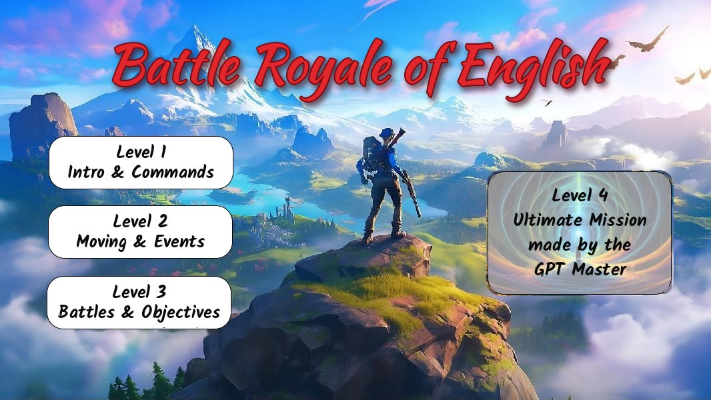
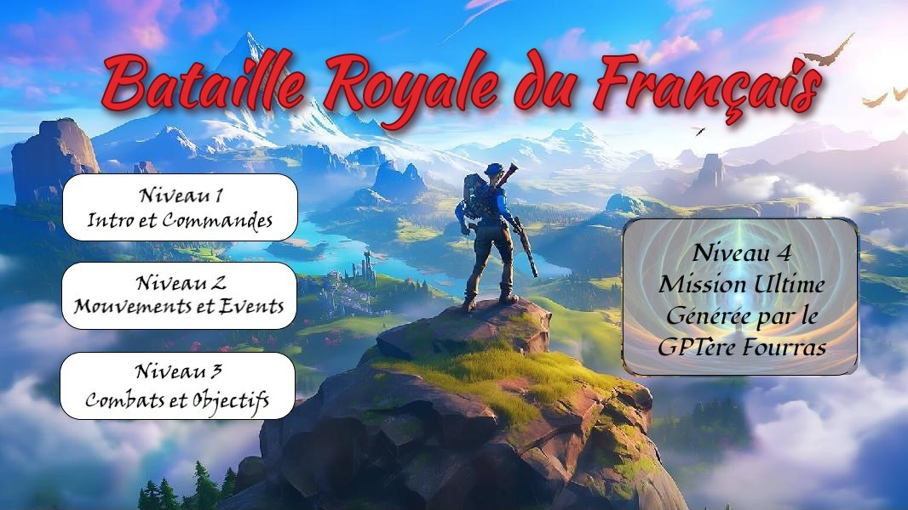

# Battle Royale of English · Bataille Royale du Français

**A homemade typing adventure that turns spelling practice into a battle royale.**
For kids aged **8 to 12**, in **English** and **French**.



---

## The story behind it

My kid loves Fortnite. Writing, not so much.

So we built a game together: the bus drops you on the island, traps snap shut on your legs, energy shields block the way, and enemies jump out of nowhere. The only way through is **writing**. You listen to a sentence, type it without mistakes, and your character jumps off the bus, breaks free from the trap or lands a hit on the boss.

It started in French and grew into a four-level adventure with an English version, built and playtested together, one level at a time.

## A tribute to 90s adventure games

If you remember the adventure games of the 90s, you'll feel at home. You explore by looking at one still picture at a time, turn left or right, step forward, and **type your commands** to act:

```
> forward
> look
> 3. the dragon flew over the castle walls
```

No mouse, no fast reflexes: just a keyboard, some imagination, and the pleasure of a sentence typed right.

## How it teaches

- **Listen, then write.** Every sentence is read aloud (Ctrl + 1, 2 or 3) and must be typed from memory, like a dictation in disguise.
- **Instant feedback, word by word.** As soon as a word is wrong, the game flags it and gives a hint: *their / there / they're*, *-ed* or irregular past, silent letters… and in French: *a / à*, *son / sont*, agreements, silent endings, *o / eau*…
- **Difficulty is a choice.** In battles, the weapon *is* the sentence: the pistol needs a short one (−1 life), the machine gun a medium one (−2), the shotgun a long one (−3, one shell only). Kids pick their own challenge.
- **Conjugation without the boredom.** To get Everest the dog to fight on your side, you conjugate a verb for her (*I am, you are, she is…* / *je suis, tu es, il est…*).
- **Reading comprehension.** Riddles tell you where to search, hints tell you where the enemies hide, and you have to read carefully to pick the right object.
- **Made to be adapted.** All sentences are plain text files (one sentence per line). Parents and teachers can swap in this week's spelling list in five minutes with Notepad.

## The levels

| Level | What happens | What you practise |
|---|---|---|
| **1 · Intro & Commands** | Jump off the battle bus, dive, open your glider, land. | Listening and typing your first sentences |
| **2 · Moving & Events** | Locked inside the Lavish Lair: explore 9 rooms, survive traps and energy shields, find the card with the door code. | Moving around with typed commands, short dictations |
| **3 · Battles & Objectives** | Find the car keys and an ice-cold Nuka-Cola, and fight your way through Darth Vader, Mario, Ash & Pikachu, then a whole Naruto gang. | Choosing short, medium or long sentences in battle |
| **4 · Ultimate Mission** | A full quest in a real-looking neighbourhood: solve riddles, find hidden objects, beat three enemies and the boss. Four quests (Justice League, pirates, Pokémon, Avengers) come up in random order, without repeats. | Riddles, reading, longer sentences, conjugation |

Each level starts with a page explaining its controls, and `info` shows them again at any time. Level 4 has a city map (`city`), can be saved and resumed, and its quest can be picked in the menu (`4a`, `4b`…).



## Getting started

You need **Python 3.10+** and two packages:

```bash
pip install pygame gtts
```

Then start the game **from its own folder**:

```bash
cd fw_en      # English version
# cd fw_fr       # version française
python zz_batroy.py
```

In the menu, type `1`, `2`, `3` or `4` (or `4a`, `4b`… to choose a level-4 quest) and press Enter.

> The voice uses Google Text-to-Speech, so it needs an internet connection. Without internet, the game still runs, just without the voice.

Full player guides: [`fw_en/README.txt`](fw_en/README.txt) (English) and [`fw_fr/LISEZMOI.txt`](fw_fr/LISEZMOI.txt) (French).

## Make it your own

| What | Where |
|---|---|
| Dictation sentences (short / medium / long) | `files/texts/phrases_pet.txt`, `phrases_moy.txt`, `phrases_gde.txt` |
| Conjugations (level 4) | `files/texts/conjugaisons_*.txt`, format `what the voice says; what to type` |
| Level 4 quests | `files/data/data10.py` … `data13.py`: copy one, renumber it, change the story, places and objects |

Rules of thumb: one sentence per line, at least 48 lines per sentence file (18 per conjugation file), no punctuation (it would have to be typed too). Capital letters are ignored, and accents count.

## Under the hood

- **Python + pygame**: still images for each place and direction, text drawn at the bottom of the screen, keyboard input.
- **gTTS** reads the sentences aloud (`lang='en'` or `'fr'`).
- Each place is a node in a small graph (`gamestate.py`), and each picture is one of its four directions.
- Level 4 quests are data files: characters, zones, riddles, objects, texts. The first ones were drafted with a chatbot (the "GPT Master" in the menu); the current four were rewritten by hand to match the map.
- Two separate copies of the game: `fw_fr/` (French) and `fw_en/` (English).

## Credits & disclaimer

A free, **non-commercial fan project** made at home, for kids learning to write.

It is **not affiliated with or endorsed by** Epic Games (Fortnite), Google, Nintendo, The Pokémon Company, Roblox, Disney, Marvel, Lucasfilm, DC, Toei, Shueisha, Spin Master, Bethesda, LEGO or anyone else. All characters, images, sounds and trademarks belong to their respective owners and are used here for personal, educational fun only. If you own something used here and want it removed, please open an issue.

Voice: Google Text-to-Speech.

## License

The **code** and the **original texts** (dialogues, sentence lists, quests, docs) are released under the [MIT License](LICENSE).
The images, sounds and characters in the `files/` folders are **not** covered: they belong to their owners (see above).

---

## Version française

**Un jeu d'aventure fait maison où l'on progresse en écrivant**, pour les enfants de **8 à 12 ans**, en **français** et en **anglais**.

Mon enfant adore Fortnite, beaucoup moins l'écriture. Alors on a construit ensemble un jeu où le bus de combat vous dépose sur l'île. Pour sauter, déjouer les pièges, traverser les boucliers d'énergie et battre les ennemis, il faut **écouter une phrase et l'écrire sans faute**.

Le jeu s'inspire des jeux d'aventure des années 90 : on avance image par image et on **tape ses commandes** (`avant`, `gauche`, `fouiller`…). Le jeu signale chaque mot erroné et donne un indice (*a / à*, *son / sont*, accords, lettres muettes…). Au combat, l'arme dépend de la longueur de la phrase choisie, et la chienne Everest vient vous aider si vous conjuguez correctement un verbe.

**Quatre niveaux :**
- **1. Intro et commandes** : sauter du bus, plonger, ouvrir son planeur, atterrir.
- **2. Mouvements et événements** : sortir du Lavish Lair en trouvant le code de la porte.
- **3. Combats et objectifs** : récupérer les clés et le Nuka-Cola, et affronter une série d'ennemis.
- **4. Mission Ultime** : une quête dans un quartier, avec énigmes, objets cachés et chef final. Quatre quêtes sont tirées au hasard, sans répétition.

**Pour jouer :** `pip install pygame gtts`, puis `cd fw_fr` et `python zz_batroy.py`.

**Pour adapter le jeu :** les phrases sont de simples fichiers texte dans `files/texts/` (une phrase par ligne), faciles à remplacer par la liste de mots de la semaine. Tout est expliqué dans [`fw_fr/LISEZMOI.txt`](fw_fr/LISEZMOI.txt).

Projet de fan gratuit et non commercial, sans lien avec Epic Games ni avec les autres marques citées. Les personnages, images, sons et marques appartiennent à leurs propriétaires. Le code et les textes originaux sont sous [licence MIT](LICENSE) ; les images, sons et personnages ne le sont pas.
